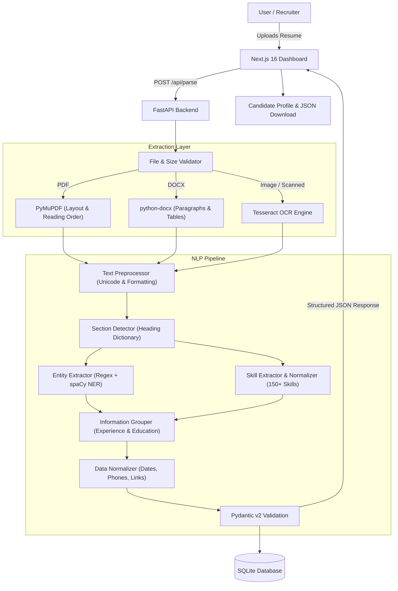

# NLP-Based Resume Parser

An intelligent, hybrid Natural Language Processing system that automatically extracts, normalizes, and groups unstructured resume data (PDF, DOCX, and images) into validated, structured candidate profiles.

---

## Architecture Overview



---

## Features

- **Multi-Format Document Parsing:**
  - **PDF:** Native extraction via PyMuPDF with `sort=True` preserving multi-column reading order. Automatic OCR fallback for scanned or image-only documents.
  - **DOCX:** Extracts formatted text from paragraphs and complex table layouts.
  - **Images (PNG, JPG, TIFF):** High-accuracy OCR powered by Tesseract.
- **Rule-Based & Statistical Section Detection:** Identifies sections including `Personal Info`, `Summary`, `Work Experience`, `Education`, `Skills`, `Certifications`, `Projects`, and `Languages`.
- **Hybrid Named Entity Recognition (NER):** Combines regex patterns (email, phone, dates, social URLs) with spaCy statistical NLP (`en_core_web_sm`) for name, company, and location extraction.
- **Intelligent Skill Extraction & Normalization:** Dictionary of 150+ technologies across Frontend, Backend, Databases, DevOps, Mobile, and AI/ML, using boundary-safe regex matching (e.g., prevents "Go" false positives in "Google").
- **Information Grouping:** Pairs companies with job titles, date ranges, and descriptions into structured employment entries; associates degrees with institutions and graduation years.
- **Strict Data Validation:** Output conforms to validated Pydantic v2 schemas; missing fields default to `None` without hallucination.
- **Modern Web Dashboard:** Next.js 16 (Turbopack, TypeScript, Tailwind CSS) providing drag-and-drop uploads, structured candidate views, and one-click JSON export.

---

## Tech Stack

| Layer | Technologies |
|---|---|
| **Frontend** | Next.js 16, TypeScript, Tailwind CSS, Lucide Icons |
| **Backend API** | Python 3.13, FastAPI, Uvicorn |
| **NLP & Extraction** | spaCy (`en_core_web_sm`), PyMuPDF, python-docx, Tesseract OCR |
| **Validation** | Pydantic v2, email-validator |
| **Database** | SQLite via SQLAlchemy 2.0 |
| **Testing** | pytest, httpx, TestClient |

---

## Getting Started

### Prerequisites

- **Python** ≥ 3.11 (3.13 tested)
- **Node.js** ≥ 18 (24 tested) & **npm**
- **Tesseract OCR** (e.g., `brew install tesseract` on macOS or `sudo apt install tesseract-ocr` on Linux)

### Backend Setup

1. Navigate to the backend directory and install Python dependencies:
   ```bash
   cd backend
   pip install -r requirements.txt
   ```

2. Download the spaCy English language model:
   ```bash
   python -m spacy download en_core_web_sm
   ```

3. Start the FastAPI development server:
   ```bash
   python run.py
   ```
   API runs at: `http://localhost:8000`  
   Interactive API docs (Swagger): `http://localhost:8000/docs`

### Frontend Setup

1. In a separate terminal, navigate to the frontend directory:
   ```bash
   cd frontend
   npm install
   ```

2. Start the Next.js development server:
   ```bash
   npm run dev
   ```
   Open `http://localhost:3000` in your browser.

---

## Running the Automated Test Suite

The test suite covers schema validation, PDF extraction, multi-column handling, DOCX extraction, OCR extraction, text preprocessing, section classification, entity extraction, skill dictionary matching, information grouping, normalization, SQLite persistence, and API endpoints:

```bash
pytest tests/ -v
```

---

## API Endpoints

- `POST /api/parse`: Upload multipart form file (`file: PDF, DOCX, JPG, PNG`). Returns structured `ParseResponse`.
- `GET /api/resumes/{id}`: Retrieve parsed resume by document ID.
- `GET /api/resumes`: List recent parsed resumes.
- `GET /health`: Server health check.

---

## Structured Output Schema Example

```json
{
  "personal_info": {
    "name": "John Smith",
    "email": "john.smith@email.com",
    "phone": "+1 555 123 4567",
    "location": "New York, USA",
    "linkedin": "https://linkedin.com/in/johnsmith",
    "github": "https://github.com/johnsmith"
  },
  "professional_summary": "Full-stack developer with 3 years of experience building web applications.",
  "skills": [
    "JavaScript",
    "TypeScript",
    "React",
    "Node.js",
    "PostgreSQL",
    "Git"
  ],
  "experience": [
    {
      "job_title": "Software Engineer",
      "company": "ABC Technologies",
      "start_date": "2023-01",
      "end_date": null,
      "description": [
        "Developed web applications using React and Node.js.",
        "Designed REST APIs and PostgreSQL databases."
      ]
    }
  ],
  "education": [
    {
      "degree": "Bachelor of Computer Science",
      "institution": "XYZ University",
      "graduation_year": 2022
    }
  ],
  "certifications": [],
  "projects": [],
  "languages": []
}
```
